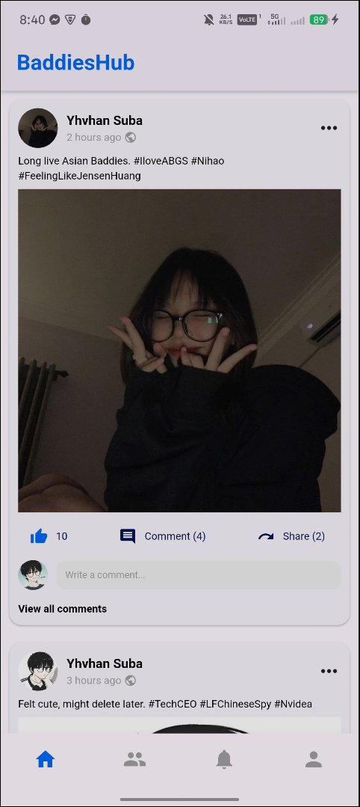
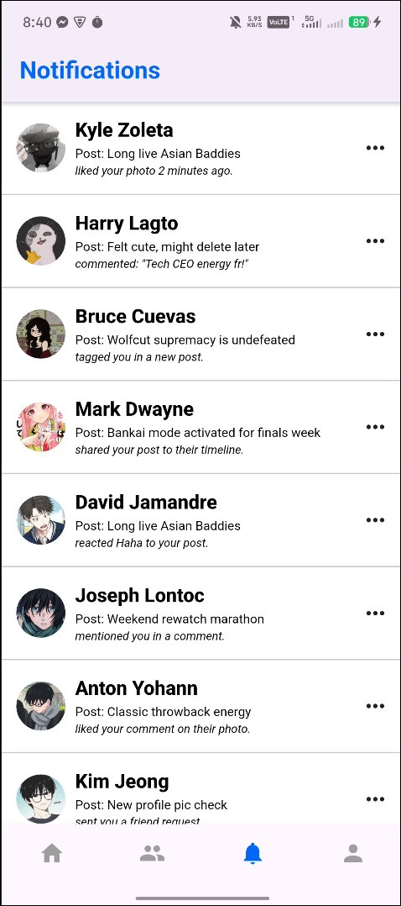

# Laboratory Discussion

## Student Information

**Name:** Yhvhan Suba

**Section:** INF245MWA

**Subject:** Mobile Programming

---

## Lab Activity 1: Discussion

### Discussion Question

**How do you integrate an image into `newsfeed_card.dart` and make it dynamic whether the post has an image or not?**

### Answer

To add an image to the newsfeed card, first declare the image folder in `pubspec.yaml`. In this project, the folder is registered under Flutter assets:

```yaml
flutter:
  assets:
    - assets/images/
```

After declaring the folder, call the image folder path in the code (for example, `assets/images/post_image.jpg`). The `NewsfeedCard` widget receives `hasImage` and `imagePath` parameters. `hasImage` indicates whether a post includes an image, while `imagePath` contains the image asset path.

```dart
hasImage == true && imagePath != null
    ? Image(image: AssetImage(imagePath!))
    : SizedBox.shrink(),
```

This condition makes the image dynamic. When `hasImage` is `true` and `imagePath` has a value, Flutter loads and displays the image using `AssetImage`. When the post has no image, `SizedBox.shrink()` displays an empty widget, so the card still works correctly without leaving a blank image area. This lets the same `NewsfeedCard` layout support posts with or without images.

---

## Lab Activity 2: Discussion

### Discussion Question

**Discuss how you manage to do the posts and the notification efficiently. Also, how you've accomplished the enhancement, state the challenges, and how you addressed them.**

### Answer

To handle the 15 posts and 20 notifications efficiently without repeating the same layout code over and over, I reused custom widgets (`NewsfeedCard` for posts and `NotificationWidget` for notifications). Instead of building each post or notification from scratch, I only had to pass different data—like the user's name, caption, date, image, profile picture, and counts—into the same reusable widget. For notifications, I stored the 20 items in a list and used `ListView.separated` so they load neatly with dividers and scroll smoothly.

For the enhancements, I updated the app step by step:
1. **Dynamic Posts (Enhancement 1):** Added comment and share counts alongside likes, dates, dynamic profile pictures, and support for both image posts (10) and text-only posts (5).
2. **Dynamic AppBar Title (Enhancement 2):** Stored the tab titles in a list so the AppBar automatically switches between **BaddiesHub**, **Friends**, **Notifications**, and **Profile** whenever the user changes tabs.
3. **Additional Navigation Tabs (Enhancement 3):** Added **Friends** and **Profile** tabs to the bottom navigation bar and connected them to their own screens with content so every tab works.
4. **Custom App Name (Enhancement 4):** Renamed the app from Facebook to **BaddiesHub** in the app title and platform configuration files (such as `AndroidManifest.xml`).

**Challenges and How I Addressed Them:**
- **Missing imports and disconnected screens:** At first, the notification files were missing imports and were not connected to the home screen's `PageView`. Adding the proper imports and wiring `NotificationScreen`, `FriendsScreen`, and `ProfileScreen` into `HomeScreen` fixed navigation between tabs.
- **Scrolling and layout overflow:** With 20 notifications, a regular `Column` would overflow the screen, and long notification text could overflow horizontally. Switching to `ListView.separated` and wrapping the notification text in `Expanded` made everything scroll and wrap cleanly.
- **Navbar icons with 4 tabs:** Adding more than 3 items to `BottomNavigationBar` causes Flutter to switch to a shifting style that can hide unselected icons. Setting `type: BottomNavigationBarType.fixed` and adding an unselected icon color kept all four tabs clearly visible.

### Output Screenshots

| Newsfeed (BaddiesHub) | Notifications |
| :---: | :---: |
|  |  |
